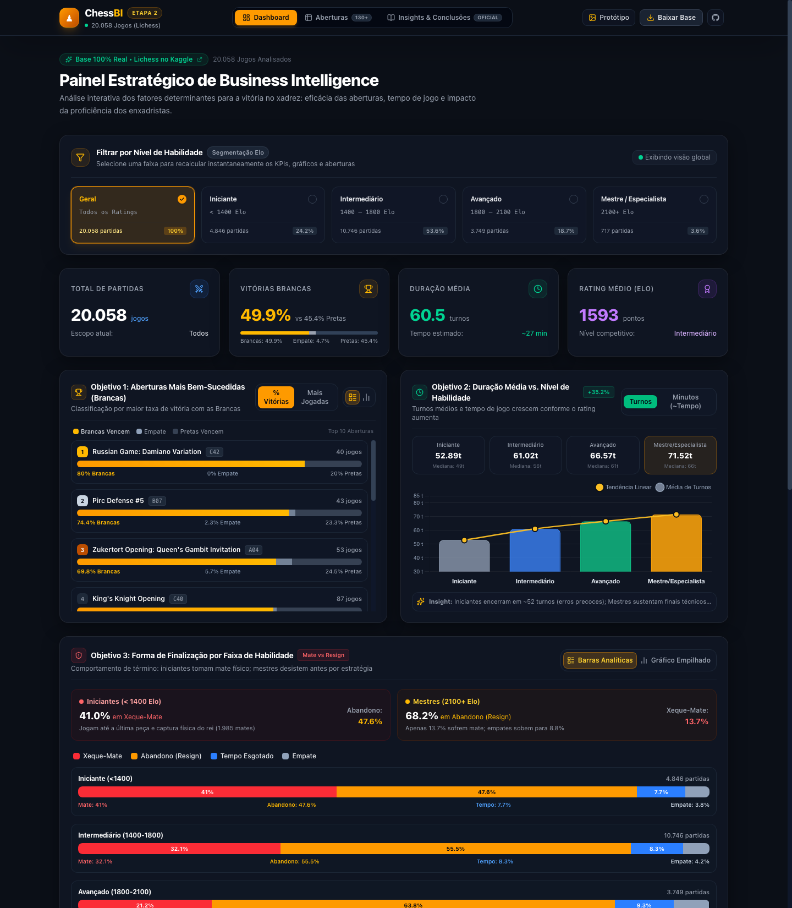
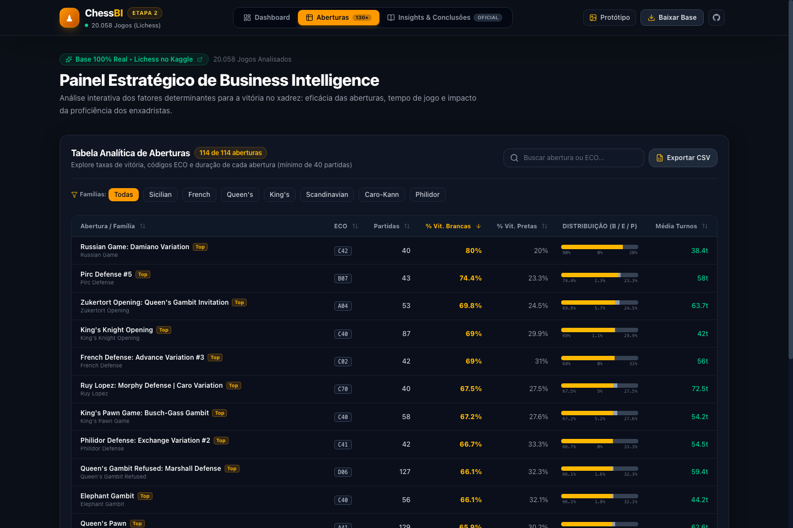
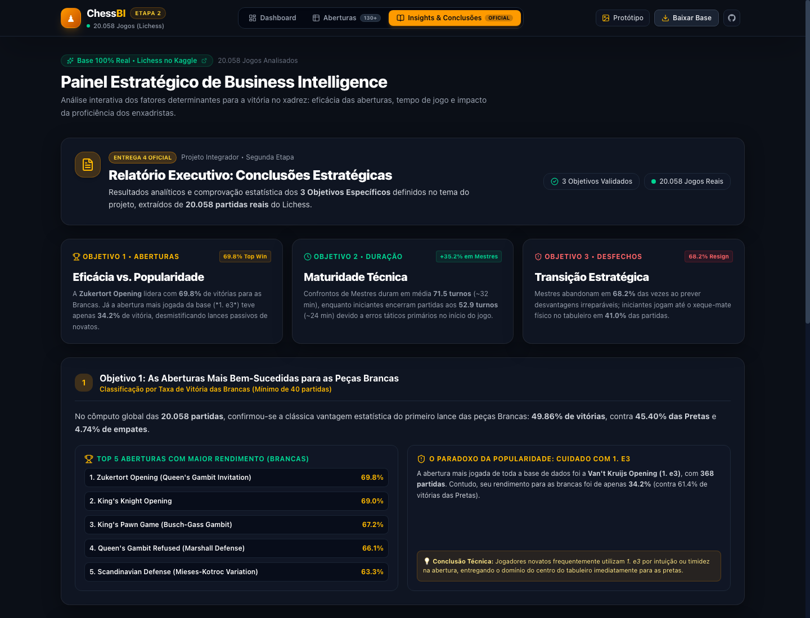
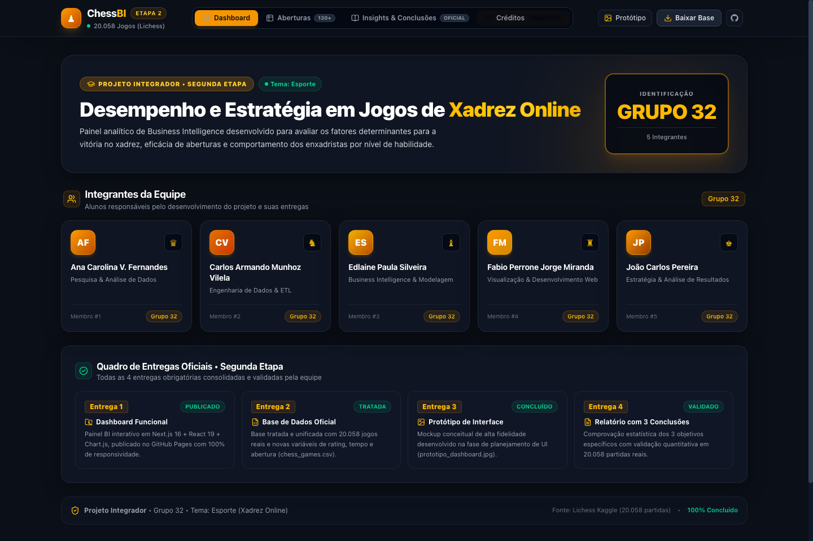

# ♟️ ChessBI — Business Intelligence em Jogos de Xadrez Online

<div align="center">


<p align="center">
  <strong>Projeto Integrador • Segunda Etapa</strong><br>
  Análise exploratória, preditiva e estratégica baseada em <strong>20.058 partidas reais</strong> do Lichess extraídas do <a href="https://www.kaggle.com/datasets/datasnaek/chess">Kaggle</a>.
</p>

[🌐 Acessar Base no Kaggle](https://www.kaggle.com/datasets/datasnaek/chess) • [📊 Ver Conclusões](./conclusoes.md) • [📥 Baixar Base Tratada](./chess_games.csv) • [🖼️ Protótipo Conceitual](./prototipo_dashboard.jpg)

</div>

---

## 📸 Demonstração Visual do Dashboard

<div align="center">
  
  <p><em>Figura 1: Visão Geral do Dashboard — KPIs em tempo real, segmentação por nível de Elo e gráficos dos 3 objetivos específicos.</em></p>
</div>

---

## 📦 Entregas Obrigatórias da Segunda Etapa

Conforme especificado nas diretrizes acadêmicas do Projeto Integrador, este repositório consolida com rigor as **4 entregas obrigatórias**:

| Item | Entrega Obrigatória | Arquivo / Link no Repositório | Descrição |
| :---: | :--- | :--- | :--- |
| **1️⃣** | **Dashboard Funcional** | [Código-Fonte (`src/`)](./src) • [Export Estático (`out/`)](./out) | Aplicação interativa em Next.js 16 + React 19 + Tailwind CSS + Chart.js com alternância de métricas, paginação e 100% responsiva. |
| **2️⃣** | **Base de Dados Utilizada** | [`chess_games.csv`](./chess_games.csv) *(8.6 MB)* | Base oficial unificada, limpa e enriquecida com variáveis de faixa de Elo, categoria de tempo e família de abertura. Fonte: [Kaggle](https://www.kaggle.com/datasets/datasnaek/chess). |
| **3️⃣** | **Protótipo do Dashboard** | [`prototipo_dashboard.jpg`](./prototipo_dashboard.jpg) | Mockup conceitual de alta fidelidade desenvolvido na fase de planejamento de interface (wireframe / ideação). |
| **4️⃣** | **Documento com 3 Conclusões** | [`conclusoes.md`](./conclusoes.md) • [Aba no Dashboard](./src/components/ConclusionsTab.jsx) | Relatório analítico formal com comprovação estatística dos 3 objetivos específicos definidos no tema. |

---

## 🎯 Síntese dos 3 Objetivos Específicos & Comprovações

```
┌────────────────────────────────────────────────────────────────────────────────────────┐
│                                 OBJETIVOS DO PROJETO                                   │
├──────────────────────────┬─────────────────────────────┬───────────────────────────────┤
│ 🏆 OBJETIVO 1            │ ⏱️ OBJETIVO 2               │ 🛡️ OBJETIVO 3                 │
│ Aberturas Mais Eficazes  │ Duração vs. Proficiência    │ Mecânica de Desfecho          │
│ Zukertort: 69.8% vitórias│ Iniciantes: 52.89 turnos    │ Iniciantes sofrem 41% de mate │
│ 1. e3 (passiva): 34.2%   │ Mestres: 71.52 turnos (+35%)│ Mestres abandonam em 68.2%    │
└──────────────────────────┴─────────────────────────────┴───────────────────────────────┘
```

### 1. As Aberturas Mais Bem-Sucedidas (Brancas)
* **Vantagem Global do Primeiro Lance:** No agregado das 20.058 partidas, as Brancas vencem **49.86%**, as Pretas vencem **45.40%** e ocorrem **4.74% de empates**.
* **Destaques Positivos:** Aberturas sólidas e agressivas superam amplamente a média:
  * **Zukertort Opening (`A04`):** **69.8%** de vitórias brancas.
  * **King's Knight Opening (`C40`):** **69.0%** de vitórias brancas.
  * **Russian Game: Damiano Variation (`C42`):** **80.0%** de vitórias brancas (punição tática contra erros pretos).
* **O Paradoxo da Popularidade:** A abertura mais jogada da base, **Van't Kruijs Opening (`1. e3`)** com 368 partidas, atinge apenas **34.2% de vitórias brancas**. Trata-se de um lance passivo comum entre novatos que entrega a iniciativa e o controle do centro.

---

### 2. Duração Média da Partida vs. Nível de Habilidade (Elo)
* **Correlação Linear Direta:** Quanto maior o nível técnico dos enxadristas, mais turnos a partida se estende:
  * **Iniciante (`< 1400`):** Média de **52.89 turnos** (~24 minutos).
  * **Intermediário (`1400 - 1800`):** Média de **61.02 turnos** (~27 minutos).
  * **Avançado (`1800 - 2100`):** Média de **66.57 turnos** (~30 minutos).
  * **Mestre / Especialista (`2100+`):** Média de **71.52 turnos** (~32 minutos) — **aumento de +35.2%**.
* **Explicação:** Enxadristas novatos cometem blunders (penduradas) nos primeiros 20 lances, enquanto mestres neutralizam ataques prematuros e conduzem a disputa para finais técnicos e demorados.

---

### 3. Forma de Finalização por Nível de Habilidade
* **Iniciantes jogam até o Rei tombar:**
  * **Xeque-Mate:** **41.0%** das partidas de iniciantes terminam em mate físico na mesa.
  * **Abandono (*Resign*):** Apenas **47.6%**.
* **Mestres reconhecem a desvantagem matemática:**
  * **Xeque-Mate:** Ocorre em meros **13.7%** dos confrontos.
  * **Abandono (*Resign*):** Dispara para **68.2%**.
  * **Empates (*Draw*):** Saltam de **3.8%** em iniciantes para **8.8%** em mestres (mais de 2x), refletindo técnica apurada de defesa e afogamento.

---

## 🖼️ Telas e Módulos do Sistema

### 📊 1. Tabela Analítica de Aberturas (Aba "Aberturas")
Permite explorar as mais de 130 variações com filtros por famílias consagradas (*Sicilian*, *French*, *Queen's*, *King's*, *Caro-Kann*), busca por código ECO, minigráficos de distribuição e **exportação em planilha CSV** (`FileSpreadsheet`):

<div align="center">
  
  <p><em>Figura 2: Tabela interativa com busca, filtros de família e exportação CSV.</em></p>
</div>

---

### 📑 2. Relatório Executivo Oficial (Aba "Insights & Conclusões")
Incorpora nativamente o relatório acadêmico no próprio dashboard, com cards executivos, comprovação estatística e fundamentação teórica:

<div align="center">
  
  <p><em>Figura 3: Aba de Conclusões Estratégicas e comprovações analíticas.</em></p>
</div>

---

### 👥 3. Equipe & Créditos (Aba "Créditos • Grupo 32")
Identificação visual dos integrantes da equipe, tema do projeto e síntese das 4 entregas realizadas:

<div align="center">
  
  <p><em>Figura 4: Aba de Créditos com identificação institucional do Grupo 32 e seus integrantes.</em></p>
</div>

---

## ⚙️ Arquitetura do Projeto & Pipeline de ETL

O projeto foi construído sobre uma arquitetura moderna e autossuficiente:

```
chess_bi/
├── src/
│   ├── app/
│   │   ├── page.js               # Controlador central do Dashboard e roteamento de abas (?tab=)
│   │   ├── layout.js             # Layout raiz com fontes e metadados SEO
│   │   └── globals.css           # Design System escuro com glassmorphism
│   ├── components/
│   │   ├── Navbar.jsx            # Header responsivo com drawer mobile animado
│   │   ├── FilterBar.jsx         # Segmentação por 5 faixas de rating (Elo)
│   │   ├── KpiCards.jsx          # Cards analíticos reativos de KPIs
│   │   ├── OpeningsChart.jsx     # Gráfico 1: Aberturas em barras tripartidas
│   │   ├── DurationChart.jsx     # Gráfico 2: Turnos/Minutos por nível de habilidade
│   │   ├── OutcomesChart.jsx     # Gráfico 3: Desfecho por nível (Mate vs Resign)
│   │   ├── OpeningsTable.jsx     # Tabela paginada com busca e exportação CSV
│   │   ├── ConclusionsTab.jsx    # Relatório executivo interativo
│   │   └── CreditsTab.jsx        # Página oficial de créditos e integrantes (Grupo 32)
│   └── data/
│       └── dashboard_data.json   # Base analítica pré-calculada para renderização ultrarrápida
├── docs/
│   └── images/                   # Screenshots reais em alta resolução para o README
├── chess_games.csv               # Base de dados oficial tratada e enriquecida (20.058 linhas)
├── process_data.py               # Script de ETL em Python (limpeza e engenharia de variáveis)
├── prototipo_dashboard.jpg       # Protótipo conceitual de alta fidelidade da Entrega 3
├── conclusoes.md                 # Relatório formal das 3 conclusões da Entrega 4
└── tema.md                       # Tema e requisitos do Projeto Integrador
```

### 🔬 Engenharia de Variáveis Realizada pelo `process_data.py`:
1. `avg_rating`: Média aritmética simples entre `white_rating` e `black_rating`.
2. `rating_tier`: Segmentação dos jogadores em 4 categorias de maestria:
   - *Iniciante:* `< 1400` (4.846 partidas • 24.2%)
   - *Intermediário:* `1400 – 1800` (10.746 partidas • 53.6%)
   - *Avançado:* `1800 – 2100` (3.749 partidas • 18.7%)
   - *Mestre / Especialista:* `2100+` (717 partidas • 3.6%)
3. `time_category`: Agrupamento dos controles de tempo em *Bullet*, *Blitz*, *Rapid* e *Clássico*.
4. `opening_family`: Agrupamento canônico da família da abertura (ex: *Sicilian*, *French*, *Queen's Gambit*).

---

## 👥 Equipe do Projeto • Grupo 32

| Integrante | Papel / Responsabilidade no Projeto |
| :--- | :--- |
| **Ana Carolina V. Fernandes** | Pesquisa Acadêmica & Análise Exploratória de Dados |
| **Carlos Armando Munhoz Vilela** | Engenharia de Dados & Pipeline ETL (`process_data.py`) |
| **Edlaine Paula Silveira** | Business Intelligence & Modelagem de Indicadores |
| **Fabio Perrone Jorge Miranda** | Visualização de Dados & Desenvolvimento Web |
| **João Carlos Pereira** | Estratégia, Validação dos Objetivos & Conclusões |

---

## 🚀 Como Executar o Projeto Localmente

### Pré-requisitos
* **Node.js** (versão 18 ou superior)
* **npm** ou **yarn**

### 1. Modo de Desenvolvimento
```bash
# Clone o repositório
git clone https://github.com/joaopereirajp/chess_bi.git
cd chess_bi

# Instale as dependências
npm install

# Inicie o servidor local
npm run dev
```
Abra o navegador em: **[http://localhost:3000](http://localhost:3000)**

---

### 2. Gerar e Testar o Build Estático (`out/`)
O projeto está configurado para exportação estática pura (`output: 'export'` no `next.config.mjs`):

```bash
# Compilar a versão estática otimizada
npm run build

# Servir a pasta gerada localmente
npx serve out
# ou com Python:
python3 -m http.server -d out 3000
```

---

### 3. Reprocessar a Base de Dados (Opcional)
Caso queira rodar o pipeline de dados novamente a partir do arquivo bruto:

```bash
python3 process_data.py
```

---

## 📚 Referências & Fontes dos Dados

* **Dataset Oficial:** [Chess Game Dataset (Lichess) no Kaggle](https://www.kaggle.com/datasets/datasnaek/chess) — 20.058 jogos reais coletados via API do Lichess.
* **Documento Temático do Projeto:** [`tema.md`](./tema.md)
* **Relatório Formal de Conclusões:** [`conclusoes.md`](./conclusoes.md)

---

<div align="center">
  <sub>Desenvolvido pelo <strong>Grupo 32</strong> para o <strong>Projeto Integrador (Segunda Etapa)</strong> • 2026</sub>
</div>
